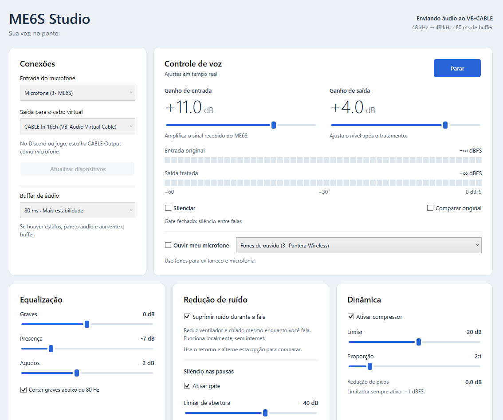
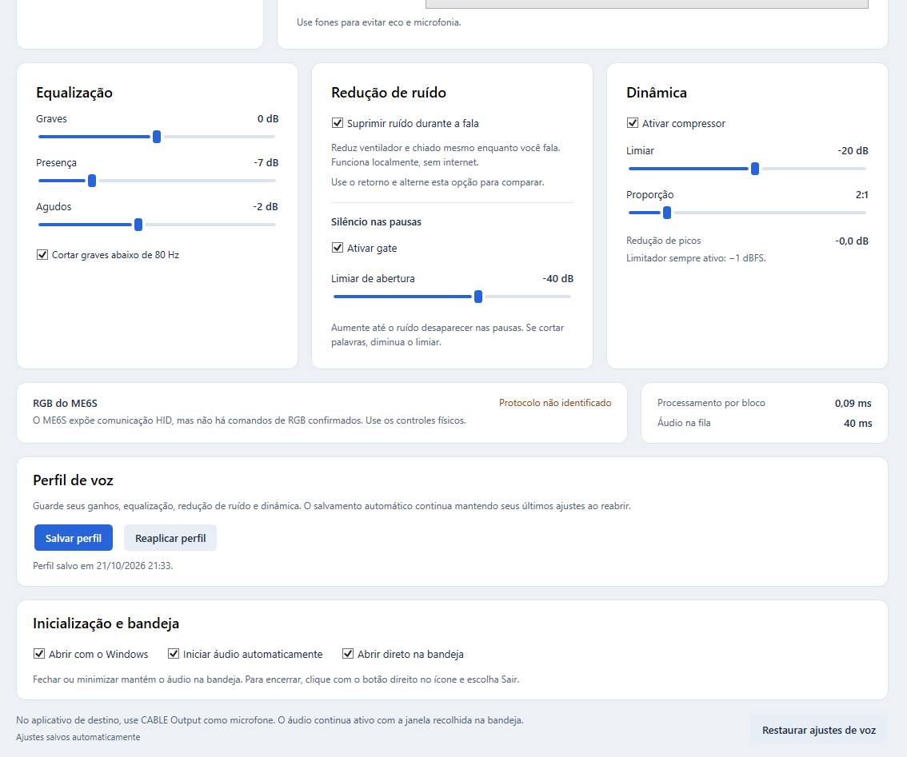

# vibeVocal Studio

**Sua voz, no ponto.** Painel local para Windows que trata o áudio de qualquer microfone (ganho, equalização, redução de ruído, gate, compressor e limitador) e envia o resultado ao [VB-CABLE](https://vb-audio.com/Cable/). Assim, Discord, jogos, OBS ou qualquer app de chamada recebem a voz já tratada.




## Recursos

- **Funciona com qualquer microfone** USB ou P2 reconhecido pelo Windows. Não instala drivers e não muda o dispositivo padrão do sistema.
- **Ganho de entrada e saída** digitais, com medidores de nível antes e depois do tratamento.
- **Equalização** de graves, presença e agudos, além do corte de graves abaixo de 80 Hz.
- **Redução de ruído durante a fala** com [RNNoise](https://github.com/xiph/rnnoise), rodando localmente sem GPU nem internet.
- **Gate** para silenciar as pausas, **compressor** ajustável e **limitador** fixo em −1 dBFS.
- **Ouvir o próprio microfone** em um fone, com o mesmo sinal tratado que vai para o cabo.
- **Perfil de voz**: salve e reaplique seus ajustes favoritos.
- **Bandeja do Windows**: abre com o Windows, inicia o áudio sozinho e fica rodando com a janela fechada.
- **Privacidade**: nada é gravado em arquivo e nada é enviado pela rede.

## Instalação

1. Baixe o `vibeVocal-Studio-Setup-x.y.z.exe` em [Releases](https://github.com/viniciuscanutx/vibeVocal-Studio/releases/latest) e execute. Não precisa de administrador nem do .NET instalado: o runtime já vem junto.
2. Instale o [VB-CABLE](https://vb-audio.com/Cable/) e reinicie o Windows. O instalador verifica se ele já existe e, se faltar, abre o site oficial no final.

> O VB-CABLE é um donationware da VB-Audio e não vem dentro do instalador: a licença dele não permite embuti-lo na instalação de outro software.

Requisitos: Windows 10 ou 11, x64.

## Começando

1. Abra o **vibeVocal Studio** pelo menu Iniciar ou pelo atalho da área de trabalho.
2. Em **Entrada do microfone**, escolha o seu microfone. Se nenhum estiver salvo, o app usa o microfone padrão do Windows.
3. Em **Saída para o cabo virtual**, escolha **CABLE Input (VB-Audio Virtual Cable)**. Evite a variante de 16 canais para uso comum.
4. Clique em **Iniciar**.
5. No Discord, jogo, OBS ou app de chamada, escolha **CABLE Output (VB-Audio Virtual Cable)** como microfone.

Pode minimizar ou fechar a janela: o áudio continua funcionando pela bandeja, perto do relógio.

## Controles

| Controle | O que faz |
|---|---|
| **Ganho de entrada** | De −24 a +24 dB, aplicado depois da captura. Não altera o ganho físico do microfone nem corrige áudio que já entrou distorcido. |
| **Ganho de saída** | De −24 a +12 dB, aplicado depois do tratamento. |
| **Equalização** | Graves em 160 Hz, presença em 3 kHz e agudos em 8 kHz, de −12 a +12 dB cada. |
| **Cortar graves abaixo de 80 Hz** | Reduz vibrações e ruídos de baixa frequência. |
| **Suprimir ruído durante a fala** | Reduz ventilador, chiado e outros ruídos com RNNoise, antes dos ganhos e efeitos. Vem ativado. |
| **Gate** | Silencia o ruído nas pausas. Se cortar sílabas, diminua o limiar ou desligue. |
| **Compressor** | Aproxima as partes baixas e altas da voz. Limiar e proporção são ajustáveis. |
| **Limitador** | Teto de −1 dBFS, sempre ativo. |
| **Silenciar** | Zera a saída do app sem mexer no mudo físico do microfone. |
| **Comparar original** | Ignora supressão, ganhos, equalização, gate e compressor. Limitador e mudo continuam valendo. |
| **Buffer** | 20, 40 ou 80 ms. Comece em 40 ms e aumente se ouvir estalos. Para trocar, pare o áudio. |



## Redução de ruído

Deixe **Suprimir ruído durante a fala** marcado e clique em **Iniciar**. Para comparar, ative **Ouvir meu microfone** com fones e ligue e desligue só a supressão enquanto fala.

O gate é independente e atua apenas nas pausas. A supressão continua funcionando com o gate desligado.

A supressão trabalha em mono a 48 kHz e acrescenta cerca de 30 ms ao caminho do áudio, além dos buffers. Pode mudar um pouco o timbre e não garante eliminar qualquer ruído, outras vozes ou distorção já capturada.

## Ouvir o próprio microfone

No painel **Controle de voz**, escolha o fone ao lado de **Ouvir meu microfone** e marque a opção. Você ouve a voz já tratada, enquanto o envio ao VB-CABLE segue normalmente. O mudo também silencia o retorno.

O fone escolhido fica salvo, mas a escuta sempre começa desligada ao abrir o app. Use fones para evitar eco e microfonia.

## Perfil de voz

**Salvar perfil** guarda ganhos, equalização, corte de graves, supressão de ruído, gate e compressor. **Reaplicar perfil** traz esses ajustes de volta sem trocar dispositivos, buffer ou preferências de inicialização.

Além do perfil, o app salva automaticamente os últimos ajustes e reabre com eles.

## Inicialização e bandeja

- **Abrir com o Windows**: registra o app para abrir quando você entra na sua conta. Desmarcar remove o registro.
- **Iniciar áudio automaticamente**: inicia a captura com os ajustes salvos. Se os dispositivos ainda estiverem carregando, tenta de novo por cerca de 28 segundos.
- **Abrir direto na bandeja**: abre com a janela oculta.

Fechar ou minimizar recolhe a janela e mantém o áudio. Para voltar, dê dois cliques no ícone da bandeja ou use **botão direito → Abrir vibeVocal Studio**. Para encerrar, use **botão direito → Sair**. Abrir o app de novo só traz a janela existente, sem iniciar outra captura.

O registro fica apenas na sua conta, em `HKCU\Software\Microsoft\Windows\CurrentVersion\Run`, valor `vibeVocal Studio`. Se mover a pasta do app, desmarque e marque **Abrir com o Windows** de novo.

## Onde ficam os ajustes

| Arquivo | Conteúdo |
|---|---|
| `%LOCALAPPDATA%\VibeVocalStudio\settings.json` | Últimos ajustes, dispositivos e preferências de inicialização |
| `%LOCALAPPDATA%\VibeVocalStudio\voice-profile.json` | Perfil de voz salvo |

Mudo e **Comparar original** não são restaurados ao abrir.

## Se não sair som

- Confirme que a entrada é o seu microfone e que a saída é **CABLE Input**.
- No app de destino, escolha **CABLE Output**, e não o microfone físico.
- Confira o mudo físico, o ganho físico do microfone e a permissão de microfone para aplicativos da área de trabalho no Windows.
- Se a saída estiver ocupada, feche o programa que estiver usando o cabo em modo exclusivo.
- Depois de desconectar ou reconectar um dispositivo, pare o áudio e clique em **Atualizar dispositivos**.

## Desenvolvimento

C# / .NET 10 / WPF. Captura pelo WASAPI compartilhado e reprodução só nas saídas do VB-CABLE, via [NAudio](https://github.com/naudio/NAudio) 2.4.

```
Audio/       enumeração de dispositivos, captura/reprodução e processamento do sinal
Models/      ajustes e modelos de dispositivos
Services/    persistência, bandeja, inicialização e instância única
ViewModels/  estado e comandos do painel
Views/       componentes WPF
Native/      rnnoise.dll e script para recompilar
tests/       verificações de DSP, interface e hardware
```

### Compilar

```powershell
./Build.ps1
```

Publica em `dist\` (framework-dependent, x64, precisa do [.NET 10 Desktop Runtime](https://dotnet.microsoft.com/download/dotnet/10.0)). Mantenha `rnnoise.dll` junto do executável ao distribuir. A origem e a forma de recompilar o RNNoise estão em [`Native/README.md`](Native/README.md).

### Instalador

```powershell
./Build-Installer.ps1 -Version 1.0.0
```

Publica self-contained (win-x64) e gera `artifacts\installer\vibeVocal-Studio-Setup-1.0.0.exe` com o [Inno Setup 6](https://jrsoftware.org/isinfo.php) (`winget install JRSoftware.InnoSetup`). O script fica em [`installer/vibeVocal-Studio.iss`](installer/vibeVocal-Studio.iss).

Para publicar uma versão, crie e envie uma tag `v*` (ex.: `git tag v1.0.1 && git push origin v1.0.1`). O workflow [`release.yml`](.github/workflows/release.yml) gera o instalador e anexa ao release no GitHub.

### Testes

```powershell
dotnet run --project tests/VibeVocalStudio.Tests.csproj -c Release                 # DSP, canais, resampling, persistência
dotnet run --project tests/VibeVocalStudio.Tests.csproj -c Release -- --profiles   # perfis e salvamento automático
dotnet run --project tests/VibeVocalStudio.Tests.csproj -c Release -- --startup    # bandeja, instância única e inicialização
./tests/New-NoiseTestSpeech.ps1
dotnet run --project tests/VibeVocalStudio.Tests.csproj -c Release -- --noise      # supressão de ruído com voz sintética
dotnet run --project tests/VibeVocalStudio.Tests.csproj -c Release -- --hardware   # microfone padrão → VB-CABLE
```

O `--hardware` abre o microfone padrão por alguns segundos e confere a recepção pelo VB-CABLE. Ele salva só métricas em `artifacts/`, nunca áudio. O `--noise` usa voz sintetizada pelo Windows e ruído gerado, sem gravar o microfone.

## Créditos

- [NAudio](https://github.com/naudio/NAudio): MIT.
- [RNNoise](https://github.com/xiph/rnnoise): BSD. Avisos em [`Native/RNNoise-NOTICES.txt`](Native/RNNoise-NOTICES.txt).
- [VB-CABLE](https://vb-audio.com/Cable/) é um produto da VB-Audio, instalado à parte.

Detalhes em [`THIRD-PARTY-NOTICES.txt`](THIRD-PARTY-NOTICES.txt).
